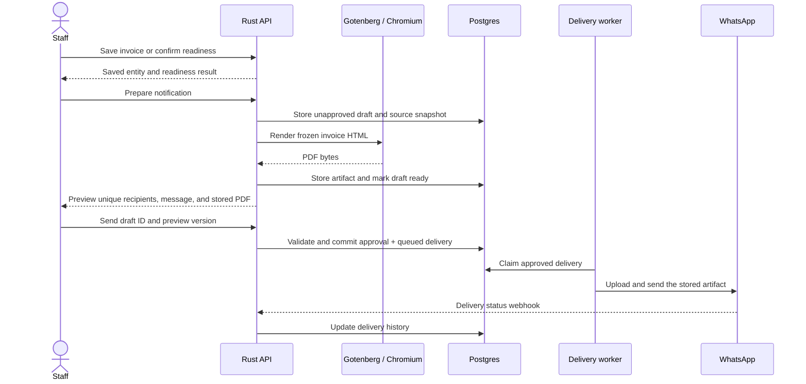

# Invoice readiness and WhatsApp notifications

Status: implemented locally and verified. Created 18 October 2026 against `361d91d`.
Live Meta delivery awaits sender configuration and a designated staging recipient.
See [setup and verification](../whatsapp-notifications.md).

## Outcome

Staff can send an invoice when it is created, resend the updated invoice after
editing, resend it independently using a dedicated button, and send a pickup
notice when its remaining orders are ready. Every outbound notification, including a resend,
requires a preview and an explicit Send action. Documents are rendered on the
server, stored, previewed, and sent using the same stored bytes.

This document records the implementation decisions. Delivery remains disabled
by default until the sender and approved templates are configured.

## Decisions and scope

- Confirm readiness per order; derive invoice readiness across all its orders.
- Keep production progress, readiness, collection, payment, and notification
  delivery as separate concepts.
- Use one shared notification subsystem for transactional and future marketing
  messages. Marketing campaigns remain a separate business workflow.
- Use Meta's WhatsApp Business Cloud API with approved utility templates for
  invoice-created and ready-for-pickup messages, including outside the 24-hour
  customer-service window.
- Render the existing bilingual invoice HTML to PDF through a private
  Gotenberg/Chromium service. Store artifacts in Postgres `bytea` initially.
- Send an invoice as a PDF document. A pickup notice is a short populated
  template by default; a branded image card is a later enhancement using the
  same artifact and approval flow.
- After a successful invoice edit, prompt staff to resend the updated invoice.
  Also provide a separate Resend invoice via WhatsApp button on invoice detail
  and in invoice list row actions. Both paths open the shared preview and
  require explicit Send; saving an edit never sends automatically.
- Select all customers associated with the invoice by default for both
  invoice-created and ready-for-pickup notifications. Include the tailoring
  customers and any named retail buyer; do not include unrelated customers.
- Send once per unique normalized mobile number for each notification event,
  even when several customers or order lines share that number. Staff review
  the complete recipient list and can deselect destinations before approval.
- Derive recipients from invoice/customer data rather than requiring a single
  invoice contact. Persist the approved recipient set and language in the
  notification snapshot. Validate phone numbers server-side and show their full
  international form before approval. Missing or invalid numbers do not prevent
  saving an invoice; show affected customers and the exclusion reason.
- Track permission for transactional WhatsApp updates separately from marketing
  opt-in. Do not treat PR #26's marketing flag as the transactional preference.
- Do not backfill readiness or send notices for existing invoices automatically.

## Existing work to reuse

Both reviewed PRs are open and have merge conflicts. Their historical backend
and frontend CI runs succeeded; real WhatsApp delivery was not verified during
this review.

| Source                                                                    | Reuse                                                                                                 | Change before integration                                                                                                                                                   |
| ------------------------------------------------------------------------- | ----------------------------------------------------------------------------------------------------- | --------------------------------------------------------------------------------------------------------------------------------------------------------------------------- |
| [PR #26](https://github.com/Ma-hawaj/fabric-sync/pull/26), head `93bf0e8` | Parent/recipient persistence, snapshotted phone numbers, provider abstraction, delivery history ideas | Replace inline sending and the success-reporting stub; add drafts, approvals, artifacts, delivery attempts, and worker claiming. Move schema additions into new migrations. |
| [PR #36](https://github.com/Ma-hawaj/fabric-sync/pull/36), head `88e4361` | Shared preview dialog concept, document designs, Cloud API upload/send/error handling                 | Replace browser PNG capture with stored server artifacts; move readiness checks into the backend; support document templates and delivery webhooks.                         |

Port selected changes onto the current application rather than merging both
branches wholesale. Preserve the current payment ledger, invoice editing
rules, pagination envelopes, and multi-customer collection breakdown.

## Readiness behavior

### Order lifecycle

Extend `orders.status` from `pending | collected` to
`pending | ready | collected`. Display those values as In progress, Ready for
pickup, and Collected. Use `collected` consistently in the database, API, and interface.

Add `ready_at`, `ready_by` (the authenticated subject), and a monotonically
increasing readiness version. Retain confirmation metadata on collection.
Record the relevant production and pickup locations at confirmation so a later
stock-based inference cannot silently change what staff confirmed.

The backend allows Mark ready for pickup only when:

1. The order has not been collected.
2. Every applicable production stage is done or explicitly skipped.
3. No open or in-progress repair blocks this uncollected order.
4. Production and pickup locations are resolved. Resolve legacy unknown or
   inferred production locations explicitly before confirming readiness.
5. If the locations differ, delivery to the invoice's pickup branch is recorded
   as done at that branch. A skipped transfer or a different destination is not
   evidence that the garment has arrived.
6. Staff explicitly confirm that the garment is available at the pickup branch.

Completing the final production stage can offer the readiness action; it must
not automatically mark the order ready or send a message. An empty stage
catalog alone must never imply readiness.

Marking an already-ready order ready is idempotent and preserves its original
timestamp. Collected orders cannot be marked ready again. Reopen production
requires a reason and clears readiness. Reopening a stage, changing a relevant
location, or opening blocking rework on a ready order must perform that
invalidation in the same transaction and invalidate unstarted pickup notices.

Stage catalog changes cannot automatically confirm readiness or trigger a
notification. Repairs raised after collection remain their own workflow and do
not reverse the original collection.

Existing collection/payment endpoints continue to support counter collection
even when the checklist was not maintained. Collecting an order does not invent
a ready confirmation or trigger a pickup notice.

### Invoice aggregation

Calculate this server-side across the complete invoice, independently of list
pagination, payment status, and browser query caches:

| Status           | Rule                                                                                   |
| ---------------- | -------------------------------------------------------------------------------------- |
| Not applicable   | No tailoring orders; retail products and gift cards do not create pickup readiness.    |
| Collected        | Every tailoring order has status `collected`.                                           |
| Ready for pickup | At least one order remains uncollected and every uncollected order has status `ready`. |
| Partially ready  | Some uncollected orders are ready and others are pending.                              |
| In progress      | Uncollected orders exist and none is ready.                                            |

Expose `readinessStatus`, `readyOrderCount`, `pendingOrderCount`, and the existing
collection counts on invoice list/detail responses. A useful display is
`2 ready · 1 in production · 1 collected`.

Provide a bulk Mark remaining orders ready action. Validate every uncollected
order first; either confirm them all or return blockers per order without a
partial write. Follow the existing invoice-before-order lock order, locking
multiple orders in a stable order. Serialize readiness changes with stage,
repair, location, collection, and invoice edits affecting eligibility.

Maintain an invoice readiness generation that advances only when the invoice
enters Ready for pickup again. Use it to identify the pickup event separately
from document/content versions. Already-collected orders count as fulfilled;
an entirely collected invoice never offers a new pickup notice.

## Notification and document flow



The app prepares the creation preview after a successful save. It prepares a
pickup preview when a ready action returns the invoice's transition to Ready
for pickup. Preparation runs through the same endpoint as the persistent
Notify customer action, so closing a tab or missing the initial prompt does not
prevent later notification.

Invoice saving and readiness confirmation finish before rendering or provider
calls. Skip, closing the preview, preparation failure, and send failure never
undo the saved business action. Preparation has no WhatsApp side effects,
including media uploads.

### Editing and independent resend

- After a successful invoice edit, open the shared preview in updated-invoice
  mode with the prompt: `Invoice saved. Send the updated invoice via WhatsApp?`
  Show the updated PDF, message, and current unique recipient list, with
  Send updated invoice and Not now actions. Failed or cancelled edits do not
  prompt for resend. Declining or failing to prepare/send does not undo the edit.
- The separate Resend invoice via WhatsApp button is available from the invoice
  detail toolbar and invoice list row actions, independently of editing,
  payment, readiness, or whether delivery history exists. It opens the same
  preview with the current saved invoice and never sends directly. Invalid
  destinations or an unavailable channel are explained in the preview.
- Both edit prompts and manual resends select all current eligible invoice
  customers by default and deduplicate their normalized mobiles. Do not limit
  recipients to whoever was sent an earlier version of the invoice.
- Prepare a new frozen snapshot using the current saved data. Changed invoice
  content must produce a new artifact for review; an unchanged source may reuse
  a matching stored artifact. Never resend the previous PDF by default after
  an edit. Preserve earlier approved files and delivery history.
- Record an `invoice_updated` event for an edit-triggered resend, keyed by the
  invoice and persisted edit revision. Reopening that same edit prompt reuses
  its draft rather than queuing duplicate logical deliveries. An independent
  manual resend has its own explicit request identity, so the original
  creation-event deduplication cannot block an intentional resend.
- Link to the prior notification when one exists, but allow a fresh invoice
  send when no prior notification exists. An edit or manual resend of the PDF
  must not send a pickup notice or change readiness.
- Use an approved invoice-document utility template whose wording matches the
  occasion; reuse a generic approved document template where suitable, or
  configure an approved updated-invoice variant. Preview its exact populated
  wording before sending.

### Recipients and mobile uniqueness

- Resolve all invoice customers on the server, including repeated customers
  appearing on several order lines. Both creation and pickup previews select
  every eligible unique destination by default. The pickup notice still waits
  for invoice-level readiness; this does not introduce partial-order notices.
- Parse numbers using an explicit configured default region for local numbers,
  then normalize to E.164 before grouping. Equivalent local, international,
  spaced, or punctuated representations must resolve to the same destination.
  Reject missing/invalid numbers instead of treating arbitrary digit strings
  as valid international numbers.
- For example, with Bahrain configured as the default region, `33112233`,
  `+973 3311 2233`, and `00973-3311-2233` produce one destination,
  `+97333112233`, and one delivery for that event.
- A recipient row represents a mobile destination, not a customer ID. Retain
  all associated customer IDs/names in its snapshot, so a shared family number
  appears once in the preview with the customers it covers. Choose language
  and selection at destination level.
- Apply transactional preference checks to each destination and show exclusions
  with reasons. Display the number of unique selected mobiles and disable Send
  when none remain. One failed or invalid destination must not prevent the
  other approved destinations from being processed.
- Enforce `UNIQUE (notification_id, normalized_mobile)` in the database, with
  a required canonical mobile value on recipient rows. Business-event delivery
  deduplication must also use normalized mobile rather than customer ID. Repeat
  normalization and uniqueness checks during approval; never rely on browser
  selection or a client-supplied normalized number.
- Safe retries operate on existing per-mobile delivery records and do not
  resend accepted destinations when another destination fails. Explicit resends
  use a new reviewed recipient set and delivery identity as described below.

### Frozen preview

- Capture the unique recipient set, associated customer identities, numbers,
  selection, language, template identity/version,
  populated body/footer/buttons, invoice reference, amounts, pickup location,
  branding, and attachment metadata in a server-built draft snapshot.
- Build the document HTML from that same snapshot. Refactor the document
  renderer to accept snapshot data instead of fetching live invoice data again.
- Store a source fingerprint covering all relevant invoice, payment, order,
  location, recipient membership, phone, preference, template, and branding inputs. Also retain
  explicit renderer/font versions for artifact reuse and diagnosis.
- The frontend previews the populated message and the stored PDF with every
  page accessible. It fetches PDF bytes through the authenticated API and uses
  a blob URL with a PDF viewer; use PDF.js if the target browser cannot provide
  a usable embedded viewer. Revoke blob URLs when closed.
- Send remains disabled until preparation succeeds and preview content is
  available. Show clear loading, excluded-recipient, unavailable-channel, and
  rendering-failure states.
- Approval submits a draft ID, expected preview version, and idempotency key.
  It does not accept replacement HTML, PDF bytes, unreviewed recipients, message
  text, or captions from the browser. Changed content or recipient selection
  requires a new preview/version.
- Revalidate the source and transactional messaging preference during approval
  and immediately before dispatch. Stale drafts return `409` or become stale;
  the app offers a refreshed preview. Never silently regenerate an approved
  attachment or rewrite its message.
- Dispatch claiming is the cutoff for cancellation. Changes after submission
  starts cannot recall an external message; retain its approved snapshot and
  show its actual outcome. Do not hold database locks during network calls.

The PDF sent is byte-for-byte the stored attachment staff approved. WhatsApp
controls its own chat layout and thumbnail presentation.

### Rendering and storage

Use Gotenberg's `POST /forms/chromium/convert/html` with uploaded self-contained
HTML/assets. Keep it on an internal network, pin its image/version, install
Noto Sans Arabic, respect the template's A4 `@page` settings, include print
backgrounds, and wait for fonts and images. Bound rendering time, file size,
and concurrent conversions. Rendering does not need a logged-in browser or
access to the public application URL.

Store generated files privately in Postgres initially. Read their bytes only
when previewing/downloading or uploading; omit blobs from list/history queries.
Reuse an artifact only when its complete input fingerprint matches. A retry or
resend must never rerender an existing approved attachment. A new resend draft
may reuse that artifact if its inputs still match; otherwise it prepares a new
artifact for review.

Use the artifact service for invoice PDF download/export as well. Retain the
existing HTML document route as a supported source/print route. A Chromium
failure must not mark preparation successful or enable sending. Failed and
abandoned preparations can be retried or cleaned up; artifacts referenced by
approved/sent history must remain available. Define cleanup ages as deployment
settings and include retained artifacts in database backups.

## Persistence

Use a consolidated, ordered SQLx baseline for a fresh database. There is no
active deployment to upgrade; declare the final columns and statuses directly.
Regenerate `backend/.sqlx` whenever compile-time checked queries change.

| Record                     | Required information                                                                                                                                                                                                                                                                                                                                                                                                                                                       |
| -------------------------- | -------------------------------------------------------------------------------------------------------------------------------------------------------------------------------------------------------------------------------------------------------------------------------------------------------------------------------------------------------------------------------------------------------------------------------------------------------------------------- |
| Invoice/order additions    | Customer phone/preferences and notification language defaults; readiness metadata/version; invoice readiness generation. Recipient selection is snapshotted per notification.                                                                                                                                                                                                                                                                                              |
| `notifications`            | Event kind (`invoice_created`, `invoice_updated`, `invoice_ready`, or `marketing`), creation/edit/manual-resend origin, persisted source/edit revision, invoice/campaign reference, business event key, source fingerprint, frozen template/message data, preview version, preparation state, created/approved actor and timestamps, cancellation/stale reason, and original notification reference for a resend. Generalizes PR #26's campaign-level notification record. |
| `notification_recipients`  | Notification reference, associated customer IDs/names snapshot, canonical normalized mobile, language/selection, delivery state, unique internal delivery/idempotency key, provider message ID, due/claim/lease timestamps, and latest failure. Enforce uniqueness on notification plus normalized mobile rather than customer ID.                                                                                                                                         |
| `document_artifacts`       | Invoice reference, artifact kind, input fingerprint, template/renderer/font versions, preparation state, filename/MIME type, byte length, SHA-256, PDF `bytea`, timestamps, and render failure.                                                                                                                                                                                                                                                                            |
| `notification_attachments` | Notification-to-artifact reference and attachment order; approved associations are immutable.                                                                                                                                                                                                                                                                                                                                                                              |
| `notification_attempts`    | Recipient/delivery reference, attempt number, start/finish times, provider response/message ID, retry classification, and error. Preserve every attempt instead of overwriting previous attempts on retry.                                                                                                                                                                                                                                                                 |

Separate preparation/approval from delivery. Preparation states are
`preparing | draft | prepare_failed | approved | stale | cancelled`. Recipient
states are `draft | queued | submitting | accepted | delivered | read | failed |
uncertain | cancelled`. A worker can only claim queued recipients belonging to
approved notifications with complete artifacts.

Use stable business event keys for creation and each readiness generation.
Prevent duplicate drafts/approval requests for the same active logical event
and normalized mobile, including across tabs and different customer records
sharing a number. Content versions and explicit resend IDs
are distinct from business event identity: a changed amount must not create a
second automatic invoice-created send. A resend creates a new preview and a
new delivery identity linked to the original; it never requeues an already
accepted delivery in place.

## API and application boundaries

Follow the existing feature layout: routes, handlers, service, repository, and
types. Add `features/notifications` and a shared document-artifact/rendering
service; keep Meta transport behind the provider abstraction. Extend the
existing orders/invoices features for readiness and aggregation.

All paths below are under the existing `/api` prefix. Staff-facing endpoints
use the existing bearer-token middleware and invoice access rules.

| Endpoint                                              | Responsibility                                                                                                                                                                                                                                  |
| ----------------------------------------------------- | ----------------------------------------------------------------------------------------------------------------------------------------------------------------------------------------------------------------------------------------------- |
| `POST /orders/:id/ready`                              | Validate and confirm one order; return updated order and invoice readiness transition/generation.                                                                                                                                               |
| `POST /orders/:id/reopen`                             | Reopen an uncollected order with a reason and invalidate relevant unstarted pickup drafts/deliveries.                                                                                                                                           |
| `POST /invoices/:id/ready`                            | Atomically confirm all eligible uncollected orders or return blockers.                                                                                                                                                                          |
| `POST /invoices/:id/notifications`                    | Resolve all invoice customers, normalize/deduplicate mobiles, and prepare/reuse an unapproved creation, edited-invoice, pickup, or manual-resend draft; return its ID and preparation state. All eligible destinations are selected by default. |
| `GET /invoices/:id/notifications`                     | Return notification history and delivery outcomes.                                                                                                                                                                                              |
| `GET /notifications/:id`                              | Return frozen preview data, attachment references, version, and preparation/delivery state.                                                                                                                                                     |
| `POST /notifications/:id/send`                        | Validate expected preview/source versions and commit approval plus queued deliveries idempotently.                                                                                                                                              |
| `POST /notifications/:id/cancel`                      | Cancel an unstarted notification; do not claim that a submitting message was recalled.                                                                                                                                                          |
| `POST /notifications/:id/resend`                      | Prepare a fresh, linked draft from current saved invoice data for explicit review; never send directly or silently reuse an outdated attachment.                                                                                                |
| `POST /invoices/:id/documents`                        | Prepare/reuse a PDF artifact for the current invoice snapshot.                                                                                                                                                                                  |
| `GET /documents/:id` and `GET /documents/:id/content` | Return artifact metadata or authenticated file bytes.                                                                                                                                                                                           |
| `GET /notifications/capabilities`                     | Expose channel/template/rendering availability without credentials.                                                                                                                                                                             |
| `GET /webhooks/whatsapp`                              | Perform Meta's verification challenge using the configured verification token.                                                                                                                                                                  |
| `POST /webhooks/whatsapp`                             | Verify Meta's signature against the raw body, then process delivery events idempotently.                                                                                                                                                        |

Webhook routes use provider verification rather than staff bearer tokens.
Return normal application errors for validation, missing entities, conflicts,
and unavailable configuration. A missing renderer or WhatsApp configuration
must leave the rest of the application usable.

## Delivery worker and WhatsApp integration

- Start a bounded background worker from the Rust application. Use Postgres as
  the durable queue; no separate queue service is needed for the first release.
  Use short claim transactions with `FOR UPDATE SKIP LOCKED` and leases so
  multiple application instances cannot claim the same delivery concurrently.
- Commit approval before any external request. Load the approved snapshot and
  stored bytes, upload the attachment to Meta, and send the configured approved
  utility template using the returned media ID. Persist the provider's message
  ID and distinguish accepted from delivered/read.
- Approved media templates can supply per-message document/image parameters;
  correct PR #36's comments claiming their media must be fixed. Validate the
  final payload and approved template/language with a test sender.
- Replace PR #26's text-only `send_message(to, body)` contract with a structured
  approved-message request containing template, language, parameters, and
  optional stored media. A production-unconfigured provider must never report a
  simulated successful send. Test fakes stay confined to tests.
- Retry known transient failures with bounded backoff, respecting provider
  rate-limit responses. Revalidate source eligibility before retrying. Keep the
  approved payload and attachment unchanged throughout safe retries.
- A timeout/crash after submitting to `/messages` can mean Meta accepted the
  message without the application recording its ID. Mark this uncertain and
  require reconciliation; do not blindly replay it. Internal idempotency cannot
  promise exactly-once delivery across that external boundary. Media upload
  retries alone do not send a customer message.
- Verify webhook signatures, tolerate duplicate/out-of-order events, and avoid
  downgrading delivered/read states because an older event arrived later.
- Log notification/attempt IDs, durations, and provider error codes. Keep tokens,
  full documents, and message bodies out of routine logs.

## Frontend changes

- Extend invoice/order types and list/detail displays with backend readiness
  fields, separate from payment and existing collection counts.
- Add order readiness confirmation, invoice bulk confirmation, blocker messages,
  and a reason field when reopening. Show who confirmed readiness and when.
- After successful invoice creation, open the shared notification preview.
  After the invoice enters Ready for pickup, open the pickup preview. Rendering
  errors explicitly say the save/readiness action already succeeded.
- After a successful invoice edit, open the updated-invoice resend prompt with
  the saved version. Add the separate Resend invoice via WhatsApp button to
  invoice detail and list row actions; it opens the same preview without
  requiring an edit or an earlier successful send.
- Build the shared preview/history UI under `features/notifications`, reusing
  PR #36's dialog design. Show all eligible invoice customers selected by
  default, grouped into unique mobile destinations with their associated names.
  Include destination/language selection, unique-recipient counts, exclusion
  reasons, full message, attachment viewer/download, Send, and Skip. Changed
  selections prepare a new preview version and cannot reuse a previous approval.
- Poll preparation only while pending, disable duplicate submission, and show
  queued, accepted, delivered, failed, uncertain, stale, and skipped outcomes
  accurately. Add persistent Notify customer and Preview resend actions.
- Invalidate the affected invoice, order, readiness, and notification queries
  after mutations. Do not calculate invoice readiness from one cached page of
  orders. Record edit-triggered resends separately from the original
  invoice-created event and retain their source revision and previous history.
- Wire transactional customer phone/preferences into the existing customer/invoice
  forms; marketing selection/compose screens can be adapted later to use the
  same approval service. No notification endpoint gets a preview bypass.

## Delivery milestones

1. **Integrate the foundations.** Port the relevant PR #26/#36 pieces into the
   current architecture, organize the fresh-database migrations and new feature
   boundaries, and preserve existing invoice/payment behavior. Add the minimal
   Postgres integration-test harness needed for queue/concurrency checks.
2. **Implement readiness.** Add validated ready/reopen/bulk actions, serialization
   with related mutations, server-side aggregation, event generations, and UI
   badges/actions. Complete partial-collection and location/rework cases before
   connecting notifications.
3. **Implement document artifacts.** Refactor snapshot rendering, add private
   Gotenberg with pinned fonts, durable artifact preparation/storage, authenticated
   PDF preview/download, and rendering failure/reuse tests.
4. **Implement draft and approval flows.** Resolve all invoice customers,
   normalize and deduplicate mobiles, and persist recipient selections,
   preferences, frozen message snapshots, preview versions, stale detection, cancellation, history,
   and explicit resend. Wire creation/readiness/edit prompts and the independent
   invoice resend button. At this milestone,
   previews are usable with external delivery disabled.
5. **Implement delivery.** Add the real structured Meta adapter, durable worker,
   claim/retry/uncertain-outcome handling, templates, and verified webhooks.
   Exercise all paths through a controlled test provider first.
6. **Deploy and verify in staging.** Update compose/configuration, run renderer
   and integration checks, then verify configured invoice and pickup templates
   with a designated WhatsApp test sender/recipient, including outside the
   customer-service window. Enable production delivery after those checks.

Each milestone should be independently reviewable and include its relevant
tests. Do not enable a direct-send shortcut while later milestones are pending.

## Verification and acceptance

| Area                    | Required checks                                                                                                                                                                                                                                                                                                                                                                                                                                                                          |
| ----------------------- | ---------------------------------------------------------------------------------------------------------------------------------------------------------------------------------------------------------------------------------------------------------------------------------------------------------------------------------------------------------------------------------------------------------------------------------------------------------------------------------------- |
| Readiness               | Partial readiness/collection, all collected, retail-only and empty-stage cases; outstanding stages; skipped production stages; incomplete/skipped/wrong-destination transfer; unresolved legacy production location; open repairs; reopens; catalog edits; concurrent staff actions.                                                                                                                                                                                                     |
| Recipients              | Creation, edit, manual resend, and pickup previews default to all invoice customers; repeated order lines/customer IDs, different customers sharing a mobile, local/international/00-prefixed formatting, and distinct numbers normalize correctly; missing/invalid/blocked destinations are explained; database uniqueness and concurrent approvals prevent duplicate mobile deliveries; retrying a failed destination does not resend an accepted destination.                         |
| Edit and manual resend  | A successful edit prompts with the updated PDF and current deduplicated recipients; failed/cancelled edits do not prompt; Not now and preparation/send failures preserve the saved edit; the separate detail/list Resend button works without editing or delivery history; unchanged data may reuse an artifact, edited data cannot reuse the old PDF; repeated requests for one edit revision do not duplicate sends; explicit manual resends remain possible and retain prior history. |
| Approval                | Opening/closing/skipping a preview makes zero provider calls; failed rendering blocks Send; exact recipient/text/language/file shown; changed payment, phone, pickup, readiness, branding, or template invalidates approval; two tabs/double clicks cannot queue duplicate logical sends.                                                                                                                                                                                                |
| Documents               | Real Chromium fixtures with Arabic/RTL, long names, embedded designs/QR, BHD amounts, and multiple pages; font/image readiness; render failure/timeouts; stored-byte checksum equals the preview/download/upload checksum.                                                                                                                                                                                                                                                               |
| Transactions and worker | Real Postgres tests for bulk readiness rollback, lock order, approval+queue atomicity, claim exclusivity, restart recovery, expired leases, safe retry limits, and uncertain outcomes after a possible send. Pure service tests alone do not verify these properties.                                                                                                                                                                                                                    |
| Provider and webhook    | Fake HTTP/provider tests for document upload/template payloads, disabled configuration, rate limits, permanent errors, accepted versus delivered, signature rejection, duplicate/out-of-order events, opt-out/stale state before dispatch, and explicit resend behavior.                                                                                                                                                                                                                 |
| Frontend                | Component tests for successful-save/prepare-failure separation, all customers selected by default, shared-mobile grouping/counts, deselection, exclusion reasons, preparation states, preview navigation, disabled Send, Skip, stale refresh, readiness blockers, history, resend, and current invoice/payment regressions.                                                                                                                                                              |
| Staging                 | Demonstrate creation and pickup flows to the designated test number; send outside 24 hours through approved templates; simulate a failure/retry; confirm the delivered PDF matches the approved artifact and supports multiple pages/Arabic.                                                                                                                                                                                                                                             |

Run the repository's normal gates after implementation:

```sh
# backend/ with migrated Postgres 18+
cargo sqlx prepare
cargo sqlx prepare --check
cargo fmt --check
cargo check --all-targets
cargo test --all-targets

# frontend/
pnpm run check
pnpm run lint
pnpm run test
pnpm run build
```

Add a real-renderer CI job and database-backed integration coverage. Extend CI
path filters so renderer image/font files, document templates, compose changes,
and their tests trigger the relevant checks/builds. Verify the full migration
baseline and reference/demo seeds against a fresh database.

## Deployment and completion criteria

Add Gotenberg to local and production compose on a private rendering network;
keep the app on Dokploy's existing network as well. Add configuration for the
renderer URL/timeouts/concurrency, delivery enablement, Meta sender/access token,
template names/languages, webhook app secret and verification token, phone
normalization region, retry limits, and artifact cleanup policy. Document these
in `.env.example`, README, and the repository guidance during implementation.

Pin the renderer and fonts, verify health and resource usage, and back up the
artifact tables with the existing database. Disabling outbound delivery pauses
the worker without losing approved history or preventing invoice work; a
renderer outage blocks document preparation without breaking invoice saving.

The release is complete when both notification events work through preview and
approval, the sent attachment is the approved stored file, readiness is visible
and validated independently of payment, delivery history reflects actual
provider outcomes, the fresh-database baseline initializes correctly, and the checks above
pass. Successful invoice edits offer a resend prompt, the independent Resend
invoice via WhatsApp button is available, and both paths preview the current
saved version before explicit sending. Creation, edit, manual resend, and pickup
previews select all associated customers by
default, and each approved notification produces at most one logical delivery
per normalized mobile, regardless of how many customers share that number.

## References

- [Gotenberg: HTML to PDF](https://gotenberg.dev/docs/convert-with-chromium/convert-html-to-pdf)
- [Gotenberg: HTML screenshots for an optional pickup card](https://gotenberg.dev/docs/convert-with-chromium/screenshot-html)
- [WhatsApp Business Messaging Policy](https://business.whatsapp.com/policy)
- [Meta's WhatsApp Cloud API collection](https://www.postman.com/meta/whatsapp-business-platform/collection/wlk6lh4/whatsapp-cloud-api)
